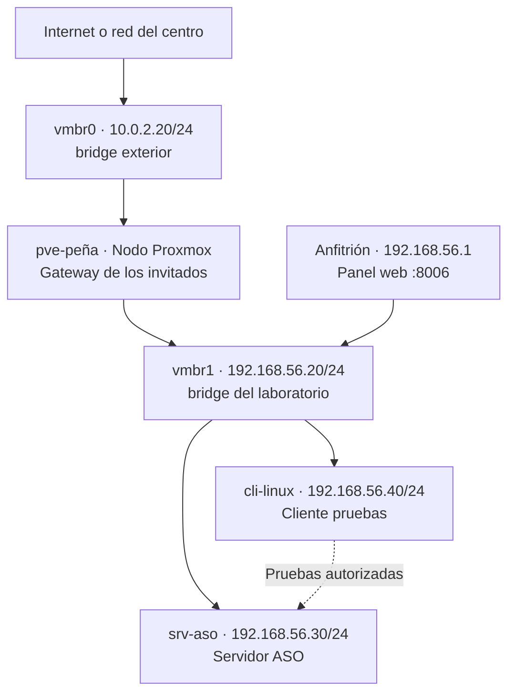

# 02-diagrama-red

## Objetivo
El objetivo es diseñar la red del laboratorio Proxmox antes de empezar a realizar la instalación de servicios.

## Diseño de red
Nombre del nodo Proxmox: pve-peña

Interfaz de gestión: 192.168.56.20/24 (vmbr1)

Bridge de Proxmox: vmbr0, es el bridge exterior y vmbr1, es el bridge del laboratorio 

Red o VLAN de laboratorio: 192.168.56.0/24

IPs de las VMs/LXC: 192.168.56.30/24 - Server y 192.168.56.40/24 - Cliente

Gateway y DNS: 
Gateway: 
- cli-linux y srv-aso: 192.168.56.20, el del nodo. 
- Nodo: 10.0.2.2, el habitual de VirtualBox. 
- DNS: 8.8.8.8

Puertos necesarios: 8006, puerto de proxmox

## Tabla
| Elemento | Nombre | IP | Función | Recursos |
|---|---|---|---|---|
| Nodo Proxmox | pve-peña | 10.0.2.20/24 (vmbr0) y 192.168.56.20 (vmbr1) | Hipervisor | Máquina Virtual |
| Servidor ASO | srv-aso | 192.168.56.30/24 | Servidor principal | Máquina Virtual/Contenedor |
| Cliente | cli-linux | 192.168.56.40/24 | Pruebas | Máquina Virtual/Contenedor |

## Evidencias

### Diagrama de red

[Volver al indice](../README.md)
