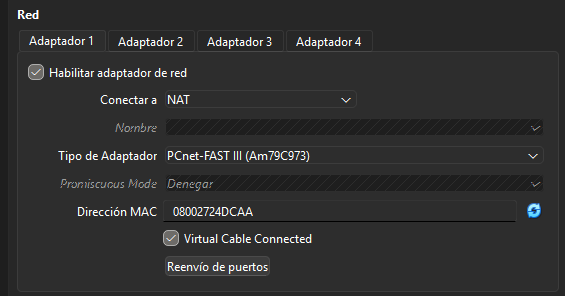
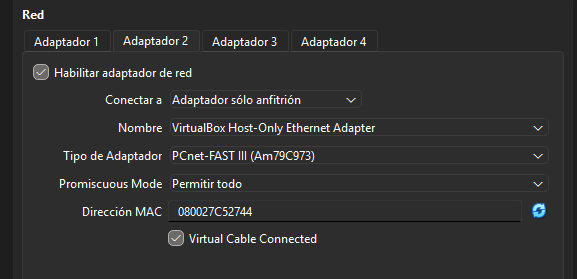
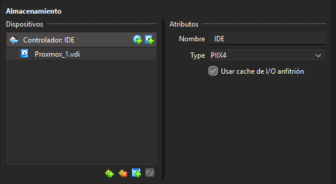
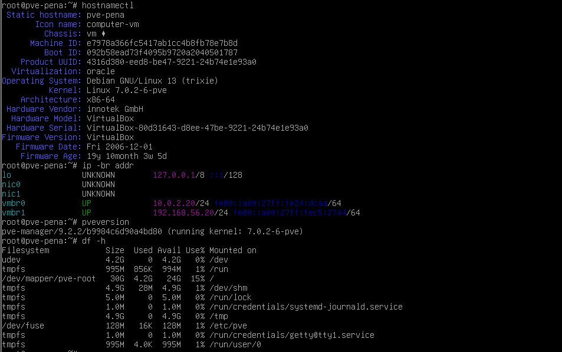
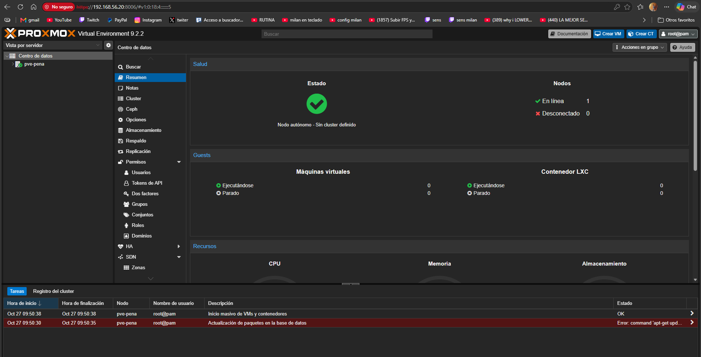

# 03-instalacion-proxmox

## Objetivo
Instalar Proxmox dentro de una máquina virtual de VirtualBox en mi portátil y dejarlo con la red que diseñé en la fase 2, para poder entrar al panel web desde el navegador.

## Procedimiento
1. Abrí VirtualBox y miré la versión en Ayuda y Acerca de VirtualBox: es la **7.2.2**.
2. Me descargué la ISO de Proxmox VE 9.2.
3. En VirtualBox creé una máquina nueva, `pve-pena`, de tipo Linux Debian 64 bits, con 10 GB de RAM, 6 CPUs y un disco de 80 GB. No le di toda la RAM del portátil para que Windows siguiera funcionando bien.
4. Le puse dos adaptadores de red:
   - Adaptador 1 en NAT, para que tenga Internet.
   - Adaptador 2 en solo-anfitrión (red 192.168.56.0/24), para poder entrar al panel desde mi PC. Le puse el modo promiscuo en "Permitir todo".
5. Con la máquina apagada, activé la virtualización anidada con VBoxManage.
6. Monté la ISO, arranqué la máquina y seguí el instalador. En la parte de red puse:
   - Hostname: `pve-pena.lab`
   - IP: `10.0.2.20/24`
   - Gateway: `10.0.2.2`
   - DNS: `8.8.8.8`
7. Al acabar quité la ISO y reinicié.
8. Como el instalador solo configura una tarjeta de red, añadí a mano el bridge `vmbr1` con la IP `192.168.56.20` en `/etc/network/interfaces`.
9. Entré desde el navegador a `https://192.168.56.20:8006` con el usuario `root` y funcionó.

## Comandos usados

```bash
# En Windows, con la máquina apagada, para activar el nested
cd "C:\Program Files\Oracle\VirtualBox"
.\VBoxManage.exe modifyvm "Proxmox" --nested-hw-virt on

# Editar la red para añadir vmbr1
nano /etc/network/interfaces

# Lo que añadí al final del archivo
auto vmbr1
iface vmbr1 inet static
    address 192.168.56.20/24
    bridge-ports nic1
    bridge-stp off
    bridge-fd 0

# Aplicar los cambios
systemctl restart networking

# Comprobaciones
hostnamectl
ip -br addr
pveversion
df -h

# Actualización (da error)
apt update
```

## Evidencias



Adaptador 1 de la máquina en NAT.



Adaptador 2 en solo-anfitrión, con el modo promiscuo en "Permitir todo".



Disco virtual de la máquina, donde está instalado Proxmox.



Comprobaciones dentro de Proxmox: el hostname, las IPs de `vmbr0` y `vmbr1`, la versión (9.2.2) y el disco.



Panel web de Proxmox abierto desde el navegador de mi portátil. Abajo se ve la tarea de actualización con error.

## Incidencias
- **Aviso de que no hay KVM.** Windows 11 tiene activada la "integridad de memoria" y eso no deja usar la virtualización anidada. 
- **El hostname no acepta la ñ**, así que el nodo se llama `pve-pena`.

## Conclusion
He conseguido instalar Proxmox dentro de VirtualBox y entrar al panel web desde mi portátil, con la red como la diseñé en la fase 2.

[Volver al indice](../README.md)
