# 03-instalacion-proxmox

## Objetivo
Instalar Proxmox dentro de una máquina virtual de VirtualBox en el equipo de clase y dejarlo con la red que diseñé en la fase 2, para poder entrar al panel web desde el navegador.

## Procedimiento
1. Abrí VirtualBox y miré la versión en Ayuda y Acerca de VirtualBox: es la **7.2.4**.
2. Me descargué la ISO de Proxmox VE 9.2.
3. En VirtualBox creé una máquina nueva, `pve-pena`, de tipo Linux Debian 64 bits, con 8192 MB de RAM, 3 vCPUs y un disco de 80 GB.
4. Le puse dos adaptadores de red:
   - Adaptador 1 en NAT, para que tenga Internet.
   - Adaptador 2 en solo-anfitrión (red 192.168.56.0/24), para poder entrar al panel desde mi equipo. Le puse el modo promiscuo en "Permitir todo".
5. Con la máquina apagada, activé la virtualización anidada con VBoxManage.
6. Monté la ISO, arranqué la máquina y seguí el instalador. En la parte de red puse:
   - Hostname: `pve-pena.lab`
   - IP: `10.0.2.20/24`
   - Gateway: `10.0.2.2`
   - DNS: `8.8.8.8`
7. Al acabar quité la ISO y reinicié.
8. Como el instalador solo configura una tarjeta de red, añadí a mano el bridge `vmbr1` con la IP `192.168.56.20` en `/etc/network/interfaces`.
9. Entré desde el navegador a `https://192.168.56.20:8006` con el usuario `root` y funcionó.

## Comandos usados

```bash
# Editar la red para añadir vmbr1
nano /etc/network/interfaces

# Lo que añadí al final del archivo
auto vmbr1
iface vmbr1 inet static
    address 192.168.56.20/24
    bridge-ports nic1
    bridge-stp off
    bridge-fd 0

# Aplicar los cambios
systemctl restart networking

# Comprobaciones
hostnamectl
ip -br addr
pveversion
df -h

# Comprobar que KVM está disponible dentro de Proxmox
egrep -c '(vmx|svm)' /proc/cpuinfo
ls -l /dev/kvm
lsmod | egrep kvm
```

## Evidencias

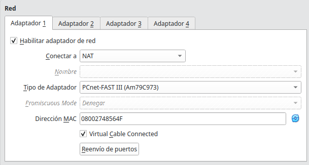

Adaptador 1 de la máquina en NAT.

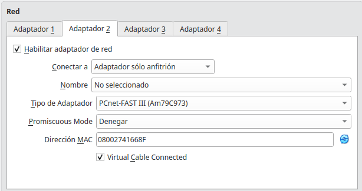

Adaptador 2 en solo-anfitrión, con el modo promiscuo en "Permitir todo".

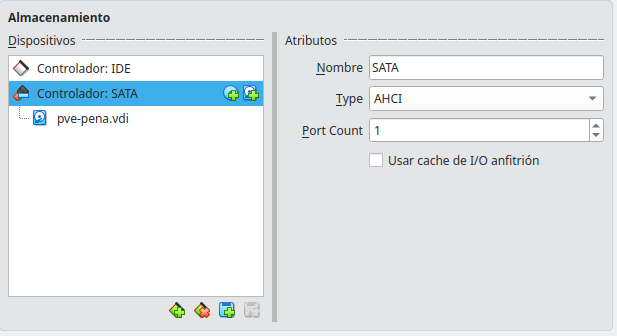

Disco virtual de la máquina, donde está instalado Proxmox.


Comprobaciones dentro de Proxmox: el hostname, las IPs de `vmbr0` y `vmbr1`, la versión (9.2.4) y el disco.


Panel web de Proxmox abierto desde el navegador de mi equipo. Abajo se ve la tarea de actualización con error.


Comprobación de KVM dentro de Proxmox: la CPU virtual tiene las extensiones vmx (6 = 3 vCPUs × 2 líneas), existe /dev/kvm y los módulos kvm y kvm_intel están cargados. La virtualización anidada funciona, así que srv-aso y cli-linux se podrán crear como máquinas KVM.

## Incidencias
- **El hostname no acepta la ñ**, así que el nodo se llama `pve-pena`.

## Conclusion
He conseguido instalar Proxmox dentro de VirtualBox y entrar al panel web desde mi equipo, con la red como la diseñé en la fase 2.

## Fase 4: Configuración base del nodo

### 1. Almacenamiento

Revisé los almacenamientos en Datacenter > Storage y desde la consola del nodo. Además creé un almacenamiento solo para copias de seguridad.

| ID | Tipo | Ruta | Contenido que admite | Total | Libre | Para qué lo uso |
|---|---|---|---|---|---|---|
| `local` | Directorio | `/var/lib/vz` | Backup, Import, ISO image, Container template | 29 GiB | 24 GiB | ISO de instalación y plantillas |
| `local-lvm` | LVM-Thin | (volumen LVM) | Disk image, Container | 30 GiB | 30 GiB | Discos de `srv-aso` y `cli-linux` |
| `backups` | Directorio | `/srv/backups` | Backup | 29 GiB | 24 GiB | Copias de seguridad |

`local-lvm` es el almacenamiento para los discos de las máquinas y no admite ni ISO ni copias, para eso están `local` y `backups`.

```bash
# Ver los almacenamientos y su espacio
pvesm status
df -h

# Crear el almacenamiento de backups
mkdir -p /srv/backups
pvesm add dir backups --path /srv/backups --content backup
pvesm status
```

En `df -h`, `local` y `backups` aparecen dentro de `/dev/mapper/pve-root`, porque los dos son carpetas de `/`. Por eso `pvesm status` les da el mismo espacio. `local-lvm` no sale en `df` porque es un volumen que no se monta: los discos de las máquinas se crean como volúmenes dentro de él. El disco de la VM es de 80 GB, pero entre `local` y `local-lvm` suman unos 60 GB, el resto es swap, metadatos de LVM y espacio libre que reserva el instalador.

**Espacio del anfitrión:**

```bash
ls -lh ~/"VirtualBox VMs"/pve-pena/
df -h ~/"VirtualBox VMs"
```

El disco `pve-pena.vdi` es dinámico: ahora ocupa 4,2 GB y puede crecer hasta 80 GB. En el disco real del anfitrión quedan 138 GB libres, así que hay espacio de sobra para que crezca.

Advertencia: Las copias de `backups` se guardan en el mismo VDI y en el mismo disco físico que el laboratorio. Si ese disco falla, se perderían a la vez las máquinas y sus copias. En un entorno real las copias deberían ir a otro disco o a otro equipo.

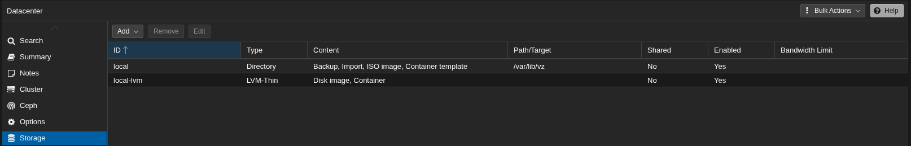

Almacenamientos del nodo en Datacenter > Storage: `backups`, `local` y `local-lvm`, con el contenido que admite cada uno.


Salida de `pvesm status` y `df -h` antes de crear `backups`.

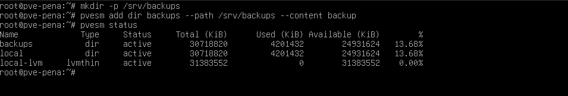

Creación del almacenamiento `backups` y comprobación de que aparece activo.


Tamaño actual del VDI y espacio libre en el disco del anfitrión.

### 2. Red

Revisé la red en pve-pena > System > Network y desde la consola del nodo.

| Interfaz | Tipo | Puerto | IP | Gateway | Adaptador de VirtualBox | Función |
|---|---|---|---|---|---|---|
| `nic0` | Tarjeta de red | — | — | — | Adaptador 1 (NAT) | Puerto de `vmbr0` |
| `nic1` | Tarjeta de red | — | — | — | Adaptador 2 (solo-anfitrión) | Puerto de `vmbr1` |
| `vmbr0` | Bridge | `nic0` | 10.0.2.20/24 | 10.0.2.2 | NAT | Salida a Internet |
| `vmbr1` | Bridge | `nic1` | 192.168.56.20/24 | — | Solo-anfitrión | Gestión y red del laboratorio |

Cada interfaz se relaciona con su adaptador de VirtualBox por la MAC: `nic0` es `enx08002748564f` (Adaptador 1, MAC `08:00:27:48:56:4F`) y `nic1` es `enx08002741668f` (Adaptador 2, MAC `08:00:27:41:66:8F`).

La IP, la máscara y el gateway coinciden con el diseño de la fase 2. La dirección de gestión es 192.168.56.20, `vmbr1`, desde donde entro al panel en `https://192.168.56.20:8006`. Solo hay una ruta por defecto, por `vmbr0` hacia 10.0.2.2, así que todo lo que va a Internet sale por el NAT. `vmbr1` no lleva gateway porque es la red interna del laboratorio.

```bash
# Interfaces y rutas
ip -br addr
ip route

# DNS y acceso al repositorio
cat /etc/resolv.conf
getent hosts google.com
apt update
```

En `ip -br addr`, `vmbr0` y `vmbr1` están UP con sus IPs. `nic0` y `nic1` no tienen IP porque son los puertos de los bridges, y salen como UNKNOWN porque la tarjeta virtual de VirtualBox no informa del estado del enlace.

Resolución de nombres: el DNS es 8.8.8.8 y funciona, porque `getent hosts google.com` devuelve su IP. El `ping` no responde, pero es una limitación de la red del instituto, no falta de conexión porque `apt update` sí descarga.

Repositorio de paquetes: `apt update` descarga sin problemas los repositorios de Debian (`deb.debian.org` y `security.debian.org`). Los repositorios enterprise de Proxmox (`pve` y `ceph-squid`) dan `401 Unauthorized` porque necesitan suscripción, por eso aparece el error de actualización en el panel. No los he desactivado porque no se ha indicado en clase, pero se podría.

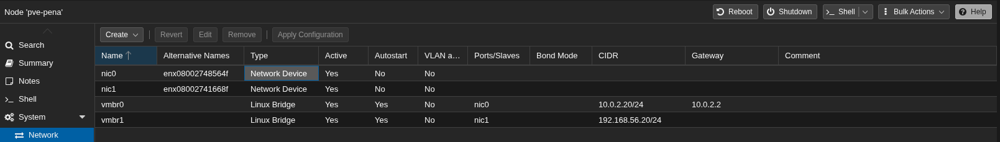

Red del nodo en *System > Network*: `nic0` y `nic1` con sus MAC y los bridges `vmbr0` (10.0.2.20/24, gateway 10.0.2.2) y `vmbr1` (192.168.56.20/24).

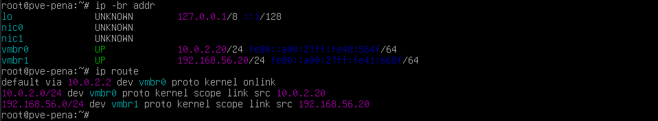

Salida de `ip -br addr` e `ip route`: los dos bridges UP y la ruta por defecto por `vmbr0`.

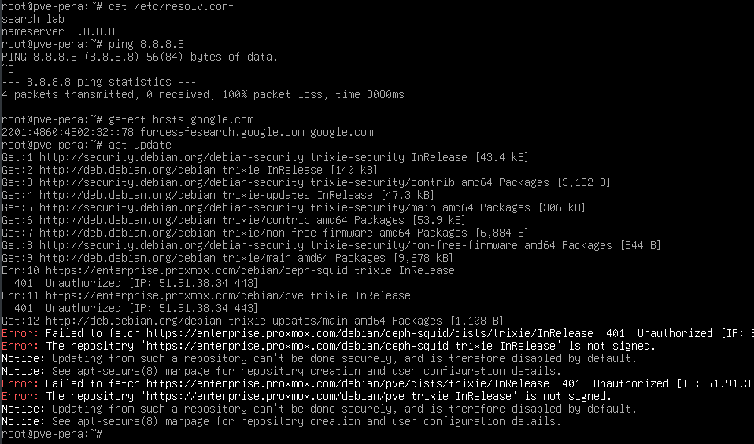

DNS configurado, resolución de nombres correcta, ping bloqueado por el NAT y `apt update` con los repositorios de Debian funcionando y los enterprise con error 401.

### 3. Accesos administrativos

Revisé las cuentas en *Datacenter > Permissions > Users* y desde la consola del nodo.

| Cuenta | Realm | Estado | Permisos | Uso |
|---|---|---|---|---|
| `root@pam` | `pam` (usuario Linux del nodo) | Activa, sin caducidad, sin TFA | Todos (superusuario) | Administrar el nodo desde el panel web y la consola |

`root@pam` es la única cuenta del nodo. Es el usuario `root` del Debian sobre el que está Proxmox, y su contraseña es la que puse en el instalador. Tiene todos los permisos sobre el nodo, las máquinas, el almacenamiento, la red y los usuarios, sin necesitar ninguna regla: por eso `pveum acl list` sale vacío. En clase no se ha pedido crear ningún usuario ni rol, así que no he añadido ninguno.

```bash
pveum user list
pveum acl list
pve-firewall status
```

Firewall: `pve-firewall status` devuelve `disabled/running`, el servicio está en marcha pero el firewall no está activado, así que no filtra nada.

Aislamiento del laboratorio:
- El panel (`https://192.168.56.20:8006`) solo es accesible desde el equipo anfitrión, porque `vmbr1` está en una red solo-anfitrión de VirtualBox que no sale a la red del aula.
- La salida a Internet es por NAT (`vmbr0`), el nodo puede salir, pero desde la red del aula no se puede entrar porque no hay reenvío de puertos.
- `srv-aso` y `cli-linux` irán en `vmbr1`, aislados de la red del centro.
- Las contraseñas no aparecen en las capturas ni en el repositorio.

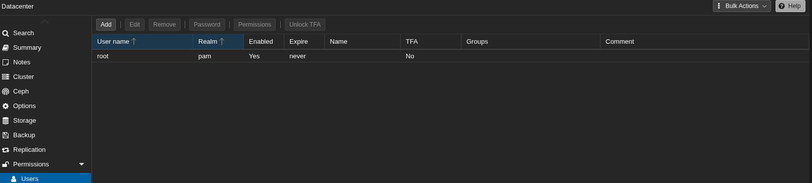

Usuarios del nodo en *Datacenter > Permissions > Users*: solo `root@pam`, activo y sin caducidad.

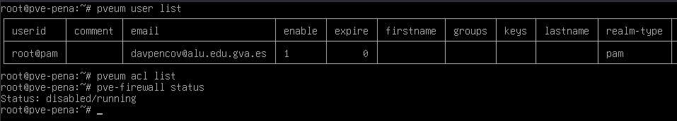

Salida de `pveum user list` (solo `root@pam`), `pveum acl list`, sin reglas, porque `root` tiene todos los permisos y `pve-firewall status`, firewall desactivado.

### 4. Reparto de recursos

Partí del presupuesto del inventario y lo ajusté con lo que he medido tras instalar.

```bash
# En el anfitrión, pc de clase
nproc
free -h

# En el nodo Proxmox
nproc
free -h
```

Datos medidos:
- Anfitrión (CLASE): 8 hilos y 15 GiB de RAM. Le doy a la VM `pve-pena` 3 vCPU y 8 GB, así que quedan 5 hilos y unos 7 GB para LliureX y VirtualBox.
- Nodo `pve-pena`: 3 vCPU y 7,8 GiB de RAM. Sin ninguna máquina encendida, Proxmox gasta 1,5 GiB.
- Almacenamiento: `local-lvm` tiene unos 30 GiB para discos de máquinas, y `local`/`backups` unos 24 GiB libres.

| Elemento | CPU/vCPU | RAM | Disco o almacenamiento | Motivo del reparto |
|---|---|---|---|---|
| Nodo Proxmox | 3 vCPU (compartidas con las máquinas) | 2 GB reservados | Sistema en `local`  | Proxmox gasta 1,5 GiB sin máquinas, con 2 GB el panel y la consola siguen respondiendo con servidor y cliente encendidos |
| srv-aso | 2 vCPU | 2 GB | 10 GB en `local-lvm` | Es el servidor del servicio ASO y el que más carga tendrá; mantengo lo del inventario |
| cli-linux | 1 vCPU | 2 GB | 8 GB en `local-lvm` | Solo hace de cliente para probar el servicio, le bajo a 1 vCPU respecto al inventario para no repartir más CPU de la necesaria |
| Plantillas, ISO, copias y margen | — | 1,8 GB libres | Plantilla 8 GB en `local-lvm`, ISO en `local`, copias en `backups` | Margen para realizar las siguientes fases |
| Anfitrión (CLASE) | 5 hilos | ~7 GB | 138 GB libres en el disco real | Que LliureX y VirtualBox no se queden sin recursos |

Comprobación de que cabe:
- RAM del nodo: 2 + 2 + 2 = 6 GB de 7,8 GiB, y queda 1,8 GB de margen.
- Disco en `local-lvm`: 10 + 8 + 8 = 26 GB de 30 GiB, y quedan unos 4 GB. Como es LVM-Thin, los discos solo ocupan lo que se usa de verdad, así que el margen real será mayor.
- vCPU: 2 + 1 = 3, las mismas que tiene el nodo. Las vCPU se comparten, así que el nodo puede seguir funcionando aunque las dos máquinas trabajen a la vez.

No consumo todos los recursos: el objetivo es poder administrar el nodo mientras `srv-aso` y `cli-linux` funcionan.

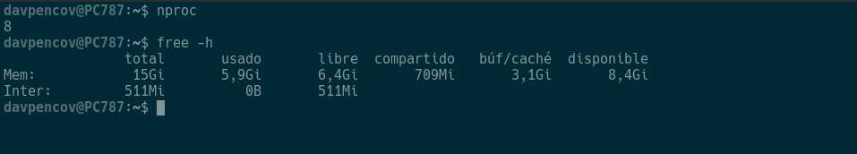

Hilos y RAM del anfitrión PC787 (`nproc` y `free -h`).

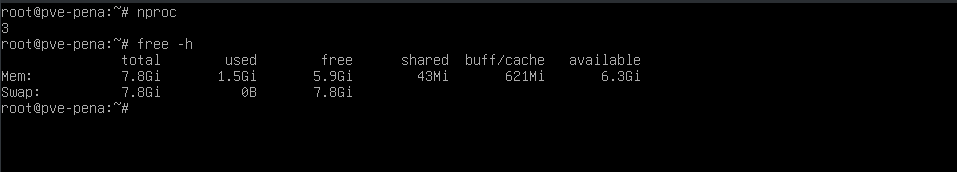

vCPU y RAM del nodo Proxmox sin máquinas encendidas: 3 vCPU y 1,5 GiB usados de 7,8 GiB.

[Volver al indice](../README.md)
