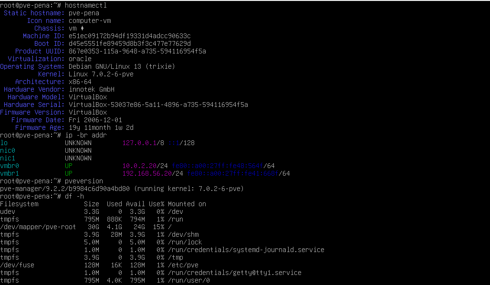
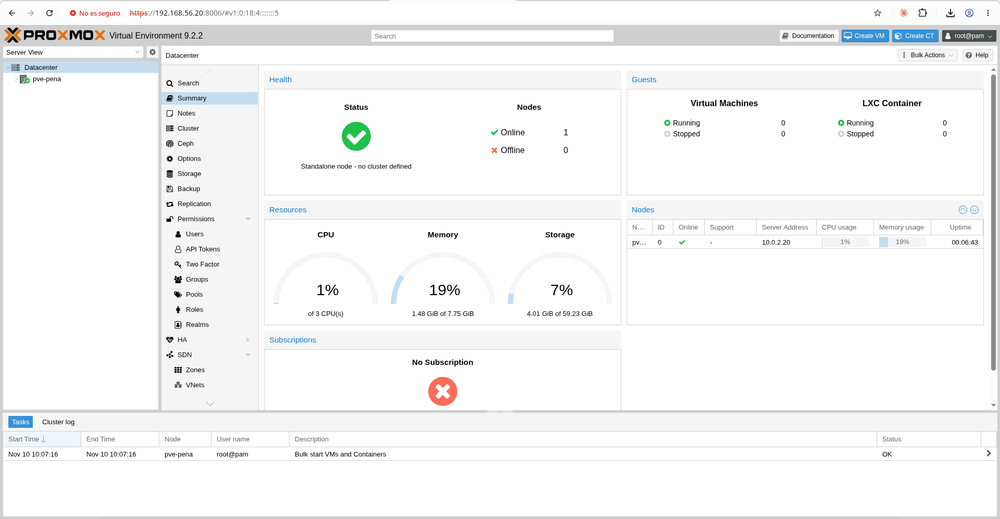
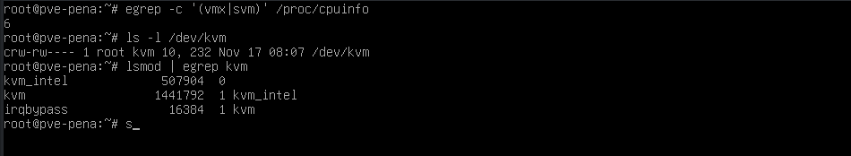
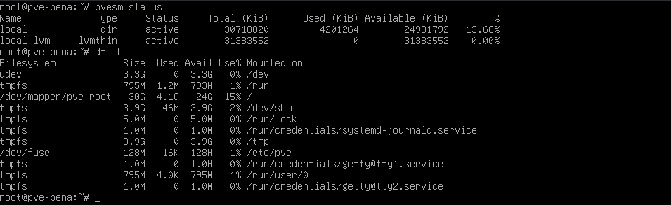
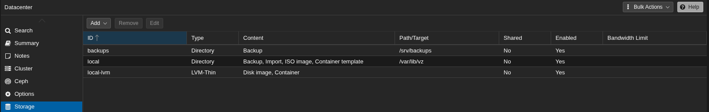

# 03-instalacion-proxmox

## Objetivo
Instalar Proxmox dentro de una máquina virtual de VirtualBox en el equipo de clase y dejarlo con la red que diseñé en la fase 2, para poder entrar al panel web desde el navegador.

## Procedimiento
1. Abrí VirtualBox y miré la versión en Ayuda y Acerca de VirtualBox: es la **7.2.4**.
2. Me descargué la ISO de Proxmox VE 9.2.
3. En VirtualBox creé una máquina nueva, `pve-pena`, de tipo Linux Debian 64 bits, con 8192 MB de RAM, 3 vCPUs y un disco de 80 GB.
4. Le puse dos adaptadores de red:
   - Adaptador 1 en NAT, para que tenga Internet.
   - Adaptador 2 en solo-anfitrión (red 192.168.56.0/24), para poder entrar al panel desde mi equipo. Le puse el modo promiscuo en "Permitir todo".
5. Con la máquina apagada, activé la virtualización anidada con VBoxManage.
6. Monté la ISO, arranqué la máquina y seguí el instalador. En la parte de red puse:
   - Hostname: `pve-pena.lab`
   - IP: `10.0.2.20/24`
   - Gateway: `10.0.2.2`
   - DNS: `8.8.8.8`
7. Al acabar quité la ISO y reinicié.
8. Como el instalador solo configura una tarjeta de red, añadí a mano el bridge `vmbr1` con la IP `192.168.56.20` en `/etc/network/interfaces`.
9. Entré desde el navegador a `https://192.168.56.20:8006` con el usuario `root` y funcionó.

## Comandos usados

```bash
# Editar la red para añadir vmbr1
nano /etc/network/interfaces

# Lo que añadí al final del archivo
auto vmbr1
iface vmbr1 inet static
    address 192.168.56.20/24
    bridge-ports nic1
    bridge-stp off
    bridge-fd 0

# Aplicar los cambios
systemctl restart networking

# Comprobaciones
hostnamectl
ip -br addr
pveversion
df -h

# Comprobar que KVM está disponible dentro de Proxmox
egrep -c '(vmx|svm)' /proc/cpuinfo
ls -l /dev/kvm
lsmod | egrep kvm
```

## Evidencias


Adaptador 1 de la máquina en NAT.


Adaptador 2 en solo-anfitrión, con el modo promiscuo en "Permitir todo".


Disco virtual de la máquina, donde está instalado Proxmox.



Comprobaciones dentro de Proxmox: el hostname, las IPs de `vmbr0` y `vmbr1`, la versión (9.2.4) y el disco.



Panel web de Proxmox abierto desde el navegador de mi equipo. Abajo se ve la tarea de actualización con error.



Comprobación de KVM dentro de Proxmox: la CPU virtual tiene las extensiones vmx (6 = 3 vCPUs × 2 líneas), existe /dev/kvm y los módulos kvm y kvm_intel están cargados. La virtualización anidada funciona, así que srv-aso y cli-linux se podrán crear como máquinas KVM.

## Incidencias
- **El hostname no acepta la ñ**, así que el nodo se llama `pve-pena`.

## Conclusion
He conseguido instalar Proxmox dentro de VirtualBox y entrar al panel web desde mi equipo, con la red como la diseñé en la fase 2.

## Fase 4: Configuración base del nodo

### 1. Almacenamiento

Revisé los almacenamientos en Datacenter > Storage y desde la consola del nodo. Además creé un almacenamiento solo para copias de seguridad.

| ID | Tipo | Ruta | Contenido que admite | Total | Libre | Para qué lo uso |
|---|---|---|---|---|---|---|
| `local` | Directorio | `/var/lib/vz` | Backup, Import, ISO image, Container template | 29 GiB | 24 GiB | ISO de instalación y plantillas |
| `local-lvm` | LVM-Thin | (volumen LVM) | Disk image, Container | 30 GiB | 30 GiB | Discos de `srv-aso` y `cli-linux` |
| `backups` | Directorio | `/srv/backups` | Backup | 29 GiB | 24 GiB | Copias de seguridad (fase 9) |

`local-lvm` es el almacenamiento para los discos de las máquinas y no admite ni ISO ni copias; para eso están `local` y `backups`. Ninguno es compartido, porque son discos locales del nodo.

```bash
# Ver los almacenamientos y su espacio
pvesm status
df -h

# Crear el almacenamiento de backups
mkdir -p /srv/backups
pvesm add dir backups --path /srv/backups --content backup
pvesm status
```

En `df -h`, `local` y `backups` aparecen dentro de `/dev/mapper/pve-root` (30G, 24G libres), porque los dos son carpetas de `/`. Por eso `pvesm status` les da el mismo espacio. `local-lvm` no sale en `df` porque es un volumen que no se monta: los discos de las máquinas se crean como volúmenes dentro de él. El disco de la VM es de 80 GB, pero entre `local` y `local-lvm` suman unos 60 GB, el resto es swap, metadatos de LVM y espacio libre que reserva el instalador.

**Espacio del anfitrión:**

```bash
ls -lh ~/"VirtualBox VMs"/pve-pena/
df -h ~/"VirtualBox VMs"
```

El disco `pve-pena.vdi` es dinámico: ahora ocupa 4,2 GB y puede crecer hasta 80 GB. En el disco real del anfitrión (`/dev/sda6`) quedan 138 GB libres, así que hay espacio de sobra para que crezca.

Advertencia: Las copias de `backups` se guardan en el mismo VDI y en el mismo disco físico que el laboratorio. Si ese disco falla, se perderían a la vez las máquinas y sus copias. En un entorno real las copias deberían ir a otro disco o a otro equipo.


Almacenamientos del nodo en *Datacenter > Storage*: `backups`, `local` y `local-lvm`, con el contenido que admite cada uno.



Salida de `pvesm status` y `df -h` antes de crear `backups`.


Creación del almacenamiento `backups` y comprobación de que aparece activo.



Tamaño actual del VDI y espacio libre en el disco del anfitrión.

[Volver al indice](../README.md)
